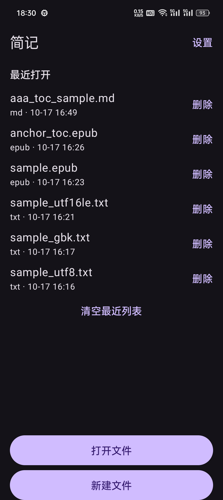
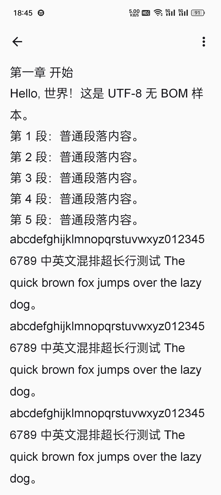
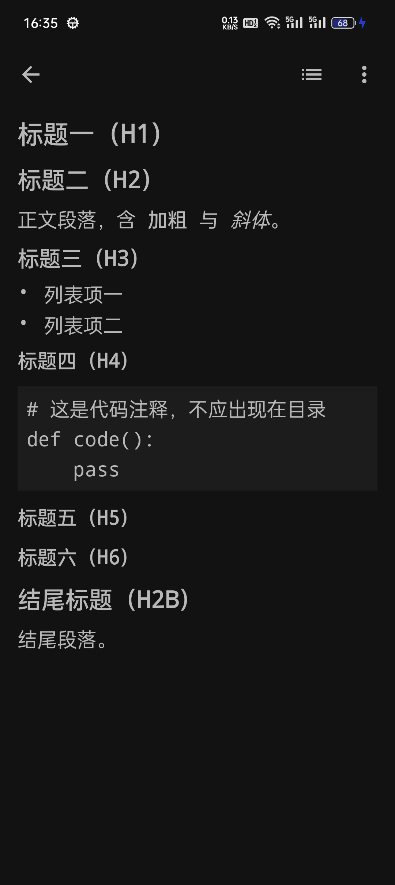
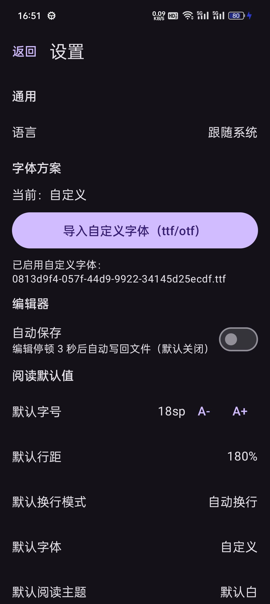

# 简记 Sample Note

一款运行于 Android 的轻量级本地文档阅读/编辑器：阅读 epub / xml / md / txt，编辑 md / txt。纯本地应用——**不联网、无账号、不采集任何数据**。

<!-- TODO: 发布后取消注释 CI badge
[](https://github.com/<org>/<repo>/actions/workflows/ci.yml)
-->

## 特性

- **格式支持**：epub（纯文本提取，兼容 epub2/NCX 与 epub3/nav.xhtml，含图片与基本 CSS 排版）、xml、md（含目录）、txt（自动探测编码：UTF-8 / UTF-16LE/BE / GBK，Latin-1 兜底）
- **阅读**：自动换行 / 不换行（横向滚动）双排版、字号与行距可调、阅读主题（默认白/护眼绿/柔光米黄/夜间黑）、字体方案（代码风格/衬线/无衬线/自定义导入 ttf/otf）、长按选择复制、连续滚动 + 章节面板 + 全书进度条
- **编辑**：md / txt 记事本式纯文本编辑，自动保存、草稿恢复、新建文件
- **其他**：应用内语言切换（中文/English）、复制后一键「问 AI」
- **存储**：遵循 scoped storage，仅通过 SAF 访问用户主动选择的文件，不申请 `MANAGE_EXTERNAL_STORAGE`

## 界面

| 主界面 | 阅读器 | Markdown 预览 |
| --- | --- | --- |
|  |  |  |

设置页：



## 构建与测试

需要 JDK 17 与 Android SDK（compileSdk 35）。使用 Gradle Wrapper，无需自行安装 Gradle。

```bash
./gradlew assembleDebug              # 构建 debug 包
./gradlew testDebugUnitTest          # 单元测试（Robolectric）
./gradlew connectedDebugAndroidTest  # 仪器测试（需 API 26+ 模拟器/真机）
./gradlew check                      # 含 fixtures 校验
```

- 支持版本：minSdk 26 / targetSdk 34
- 测试夹具由 `buildSrc` 中的 `FixtureGenerator.kt` 自动生成（`generateFixtures`），不要手工修改生成的文件。

## 技术栈

Kotlin 2.0 / Jetpack Compose (Material 3) / MVVM + StateFlow / Room + DataStore / Coroutines。**零第三方解析依赖**：epub 解析与文本编码探测均为自实现。详见 [AGENTS.md](AGENTS.md) 与 [docs/软件设计文档.md](docs/软件设计文档.md)。

## 参与贡献

欢迎 Issue 与 Pull Request，详见 [CONTRIBUTING.md](CONTRIBUTING.md)。

## 声明

- **字体**：本项目不打包任何字体文件。自定义字体功能由用户通过 SAF 自行导入其合法持有的 ttf/otf 文件。
- **隐私**：无网络权限，无账号系统，不采集、不上传任何用户数据；阅读进度等仅保存在设备本地。
- **商标**：「简记」「Sample Note」名称及应用图标不代表授予任何商标使用权（Apache-2.0 第 6 条）。

## License

[Apache License 2.0](LICENSE)。各源文件头部保留的版权注释（如有）与此一致。
