::: {.cover}
# 简记文档阅读编辑软件

## 用户操作说明书

版本号：V1.0

编制日期：2026 年 10 月
:::

# 1 软件概述

## 1.1 软件简介

简记文档阅读编辑软件（英文名 Sample Note，以下简称“本软件”）是一款在 Android 手机和平板上使用的本地文档工具，主要用来读电子书、看文本笔记、改 Markdown 文件。它处理 epub、xml、md、txt 四种格式，其中 md 和 txt 可以直接编辑，epub 和 xml 只读。

本软件完全离线运行：没有账号登录，没有服务器，没有广告和统计组件，用户打开、阅读、修改的文件始终留在设备上或用户自己选择的存储位置，本软件不会把任何文档内容传出设备。

## 1.2 主要功能

1. **文档打开**：通过 Android 系统自带的文件选择器（SAF）选取本地文件；也可以在其他应用里用「打开方式」把文档交给本软件。
2. **多格式阅读**：epub 按章节展示，支持文件自带目录、正文插图、封面和基本文字样式；md 提供源码视图和只读预览视图，并支持标题目录；xml 按纯文本展示；txt 打开时自动探测编码。
3. **阅读排版**：自动换行与不换行（横向滑动）两种方式；字号 12~24 sp 七档、行距 120%~200% 四档；字体可选代码风格、衬线、无衬线或用户自己导入的 ttf/otf；四种阅读主题（默认白、护眼绿、柔光米黄、夜间黑），全部即时生效并记住上次选择。
4. **文本编码**：txt 自动识别 UTF-8、UTF-16LE、UTF-16BE、GBK，识别不准时可手动切换，另有 Latin-1 兜底。
5. **阅读辅助**：epub 支持跨章连续滚动，滚到一章末尾会自动接上下一章；epub 与 md 都有目录面板可跳转；长按正文可选择并复制文字。
6. **文档编辑**：md、txt 纯文本编辑，提供撤销、重做（最多 100 步）、保存、退出前提醒；可选自动保存（停顿约 3 秒写回原文件）；应用被系统回收后可恢复未保存草稿。
7. **全局设置**：语言（跟随系统/中文/English）、字体方案、编辑器自动保存、阅读默认值集中在设置页，阅读与编辑共用同一套字号、行距、字体和主题。
8. **复制后问 AI**：复制正文后，应用内出现提示，点一下即可把这段文字连同用户自定义的提问前缀发送给事先指定的第三方 AI 应用（如 DeepSeek、豆包）；本软件自身不联网、不内置任何问答能力。

## 1.3 运行环境

| 项目 | 要求 |
| --- | --- |
| 操作系统 | Android 8.0（API 26）及以上 |
| 设备形态 | 手机为主，兼容平板与横竖屏切换 |
| 网络 | 不需要 |
| 存储访问 | 经由系统文件选择器，遵循 Android 分区存储（Scoped Storage） |
| 显示 | 跟随系统浅色/深色模式 |

## 1.4 数据与隐私

本软件不申请网络权限，不含账号、广告、统计、崩溃上报组件。设置、最近文件、阅读进度只写在本机应用私有目录，详见第 8 章。

# 2 安装与启动

## 2.1 安装

1. 取得本软件的 APK 安装包。
2. 在设备文件管理器中找到该 APK 并点击。
3. 若系统提示「禁止安装未知来源应用」，按系统引导为当前文件管理器开启一次允许（该开关由 Android 系统管理）。
4. 按屏幕提示完成安装。全程不注册账号、不联网激活。

## 2.2 首次启动

1. 在桌面或应用列表中找到本软件图标：中文系统下名为「简记」，英文系统下为「Sample Note」。
2. 点击图标启动，进入首页。
3. 没有任何最近记录时，首页显示空态提示「暂无最近文件，点击下方‘打开文件’选择文档」，并提供「打开文件」按钮。

## 2.3 语言说明

界面内置中文、英文两套文案。默认跟随系统语言：系统语言为中文时显示中文，其余语言环境显示英文。用户也可在设置页手动指定，操作见 6.1 节。

## 2.4 权限说明

本软件不申请存储卡读写权限，也不申请网络权限。打开、新建、保存文件全部经由 Android 系统文件选择器完成，由用户逐次挑选具体文件。卸载本软件时，应用私有目录随应用一并清除。

# 3 首页与文件访问

## 3.1 首页组成

首页自上而下为：

- 标题栏：左侧显示应用名「简记 / Sample Note」，右侧是「设置」入口。
- 最近打开列表：每项显示文件名、格式和上次打开时间。
- 「打开文件」按钮：列表下方常驻；空态时页面中部另有一个同名按钮。
- 「新建文件」按钮：页面底部，用于新建 Markdown 或纯文本文件。

{width=60mm}

## 3.2 打开文件

1. 点击首页「打开文件」。
2. 在系统弹出的文件选择器中进入目标目录（如「下载」「文档」或云盘应用提供的目录），选中文件并确认。
3. 本软件读取并解析文件：成功则进入阅读界面；失败则在页面中给出具体原因（如不支持的格式、文件损坏、缺少 epub 描述文件等）并提供返回。

云盘等文档提供方暴露的文件同样可以打开；若对应应用未运行导致系统取不到内容，请先启动该应用后重试。

## 3.3 从其他应用打开

在文件管理器、聊天工具等应用中选择文档后，通过「打开方式 / 分享」选择「简记 / Sample Note」，即可直接阅读。该入口支持 `content://` 与 `file://` 地址以及 text、epub 等常见 MIME 类型。

## 3.4 最近打开列表

- 点击记录直接重新打开该文件。
- 记录右侧的「删除」按钮只把该条从列表移除，不动设备上的原文件。
- 列表底部「清空最近列表」可一次移除全部记录。
- 原文件被移动、删除或授权失效时，打开会提示「无法打开文件」，该记录同时从列表移除。
- 列表只存文件名、地址、格式、打开时间四项，不含文档正文。

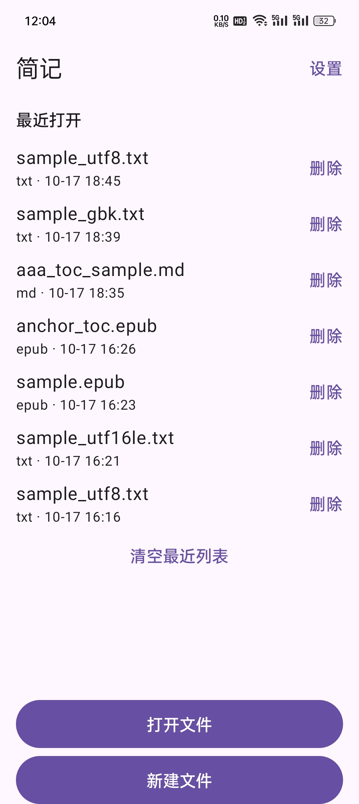{width=60mm}

## 3.5 新建文件

1. 在首页点击「新建文件」。
2. 在对话框中选择「Markdown（.md）」或「纯文本（.txt）」。
3. 系统文件选择器打开后选定保存位置；文件名预填「未命名.md / 未命名.txt」，可改。
4. 创建完成后自动进入编辑界面。

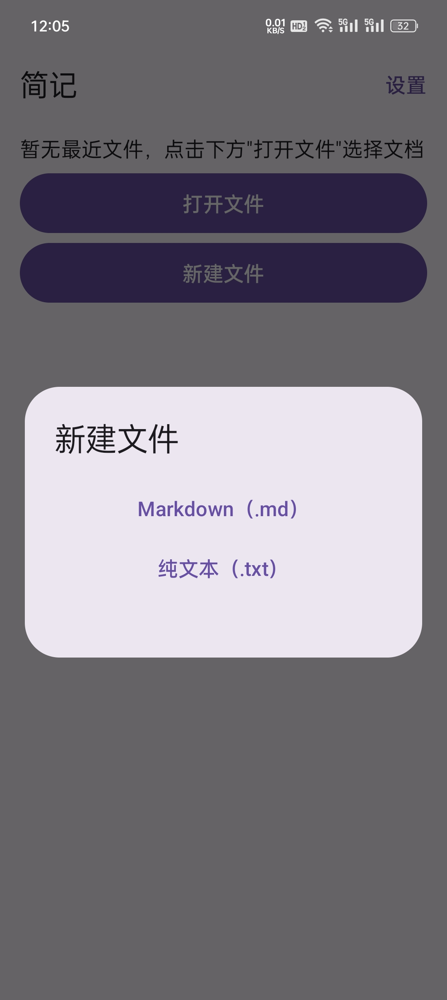{width=60mm}

保存位置请选择本软件可写入的目录；若目录由只读文档提供方管理，后续保存可能失败。

# 4 文档阅读

## 4.1 支持的格式

| 格式 | 阅读 | 编辑 | 说明 |
| --- | --- | --- | --- |
| epub | 支持 | 不支持 | 按章节展示，带文件自带目录、正文图片、封面与基本 CSS 文字样式 |
| md | 支持 | 支持 | 源码视图 + 只读预览视图，支持标题目录 |
| txt | 支持 | 支持 | 自动探测编码，可手动切换 |
| xml | 支持 | 不支持 | 按纯文本展示 |

不支持的扩展名会提示「不支持的文件格式」，应用不会闪退。

## 4.2 阅读界面组成

顶部标题栏包含：

- 左侧返回按钮：回首页。
- 中间标题：epub 显示当前章对应的目录标题；md、txt、xml 无章节概念，标题栏留空，不虚构「第 N 章」。
- 目录按钮：epub 且文件自带目录时显示章节按钮；md 且含标题时显示目录按钮；文件本身没有目录则不显示该入口。
- 右侧「⋮」菜单：含预览/源码切换（仅 md）、编辑（仅 md/txt）、阅读设置、问 AI。

正文区域不常驻底部工具条，文字尽量占满屏幕。

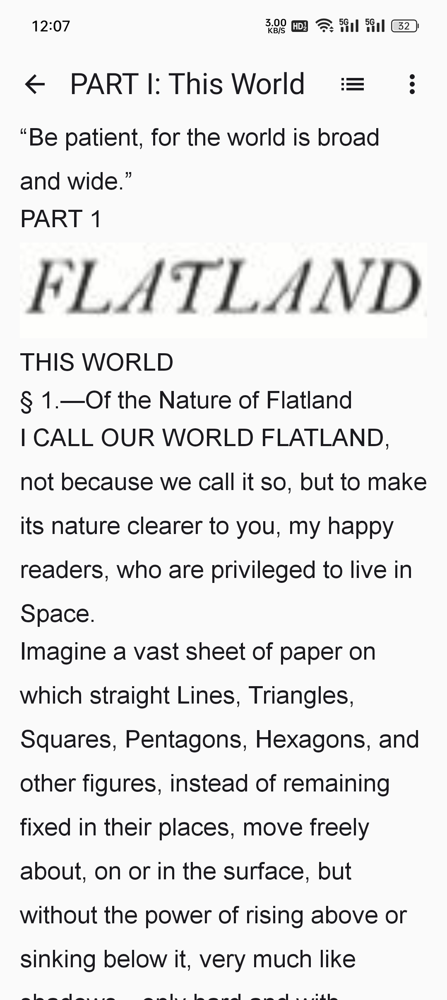{width=60mm}

## 4.3 epub 章节与目录

1. 点击顶部章节按钮，底部滑出章节面板。
2. 面板顶部有「上一章」「下一章」按钮，按书籍原顺序翻章。
3. 面板主体列出 epub 文件自带的目录条目，按原文件层级缩进；点击条目跳到对应章节或锚点。
4. 当前章节对应的条目会高亮。
5. 目录内容原样取自 epub 内部（epub3 的 nav.xhtml 优先，epub2 的 NCX 回退），本软件不生成「第 N 章」式替代条目；文件没有目录时顶部不出现章节入口。

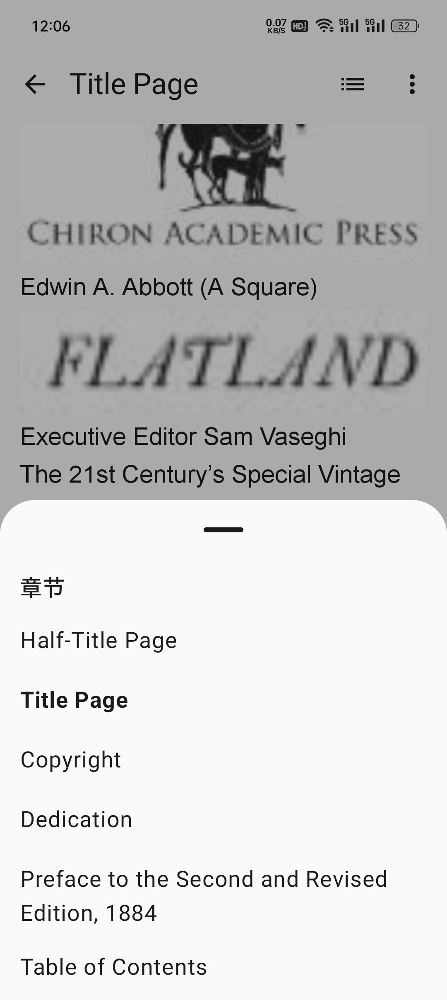{width=60mm}

## 4.4 md 目录

含标题的 Markdown 文件打开后，顶部出现目录按钮。点击后底部滑出目录面板，按 H1~H6 层级列出全部标题，点击即跳转。目录对源码视图和预览视图同样适用，切换视图时阅读位置尽量对应。

提取规则：跳过代码围栏里的「标题样式文本」；标题里的加粗、斜体、行内代码、链接等标记会被剥掉，只留可读文字。

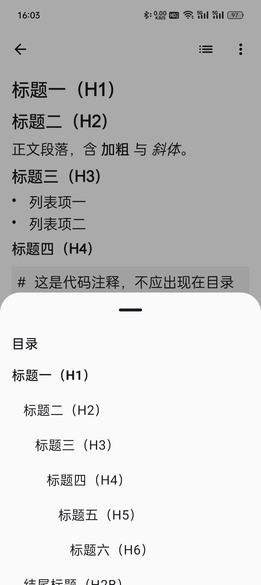{width=60mm}

## 4.5 连续滚动与阅读位置

- epub 支持跨章连续滚动：接近当前章末尾时下一章自动接续，可从全书开头一路滑到结尾。
- 章节面板中的「上一章 / 下一章」与目录是否存在无关，始终可用。
- 再次打开同一文件时恢复到上次阅读位置（按文件地址记录章节与段落坐标）。

## 4.6 阅读设置面板

点击「⋮ → 阅读设置」，底部滑出面板，分「排版」「字体」「主题」三组，所有调整即时生效并写回全局设置。

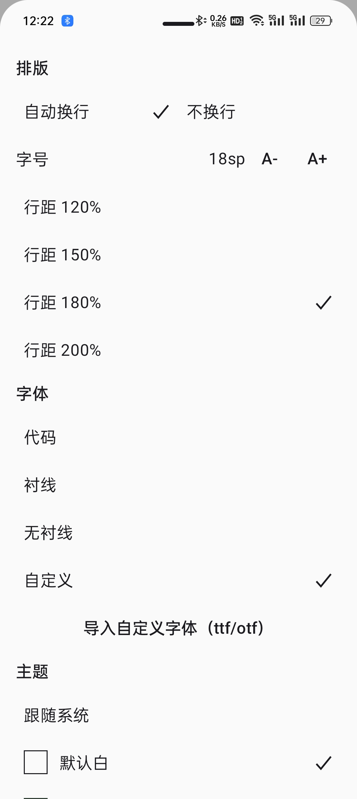{width=60mm}

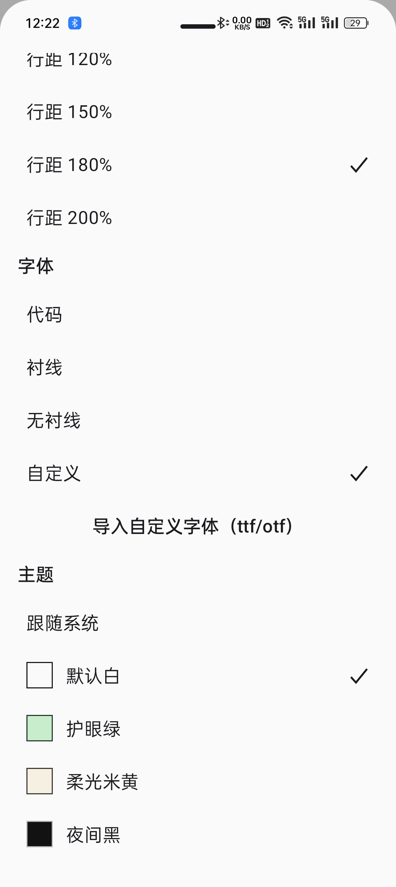{width=60mm}

### 4.6.1 排版

- 自动换行：文字到屏幕右缘自动折行。
- 不换行：每行保持原样，超出部分左右滑动查看；切换时尽量保持当前阅读位置。
- 字号：「A-」「A+」在 12、14、16、18、20、22、24 sp 七档间调节，默认 16 sp。
- 行距：120%、150%、180%、200% 四档，默认 150%。
- 编码：仅 txt 显示。默认「自动探测」，可改选 UTF-8、UTF-16LE、UTF-16BE、GBK、Latin-1。

### 4.6.2 字体

- 代码：默认方案；英文数字用系统等宽字体，中文用系统中文字体，整体呈程序编辑器风格。
- 衬线：整体系统衬线字体。
- 无衬线：整体系统无衬线字体。
- 自定义：导入过自定义字体后出现此项。「导入自定义字体（ttf/otf）」经系统文件选择器选取用户合法持有的字体文件；导入后复制到应用私有目录并立即生效。文件无效或读不出时提示「导入失败 / 字体文件无效」，原字体不变。

本软件不内置、不分发任何商业字体；需要特定字体的用户请自行准备并导入合法持有的 ttf/otf 文件。

### 4.6.3 主题

主题为前景色与背景色的成对预设：

| 主题 | 视觉效果 |
| --- | --- |
| 跟随系统（默认） | 系统浅色对应「默认白」，系统深色对应「夜间黑」 |
| 默认白 | 微淡灰白底、深色文字 |
| 护眼绿 | 豆沙绿底、深绿灰文字 |
| 柔光米黄 | 暖黄低饱和底、深褐文字 |
| 夜间黑 | 深色底、浅灰文字 |

手动选定某主题后以选择为准，不再随系统深浅色联动；改回「跟随系统」恢复联动。目录面板、菜单、提示文字等弹层元素也按当前阅读主题配色，保证明暗主题下都可辨认。

::: {.theme-grid}
| 图 4-6 护眼绿 | 图 4-7 柔光米黄 |
|:---:|:---:|
| 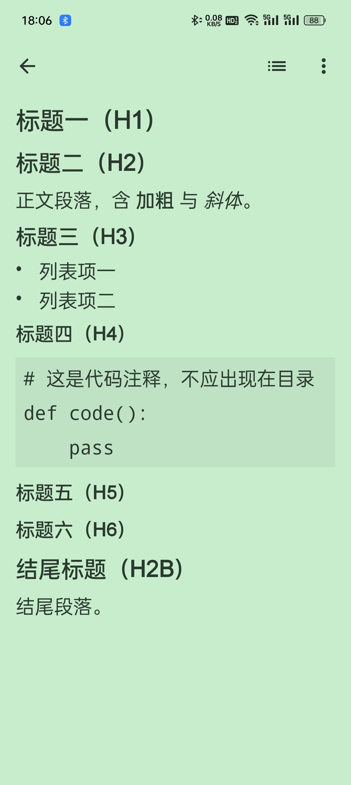{width=38mm} | 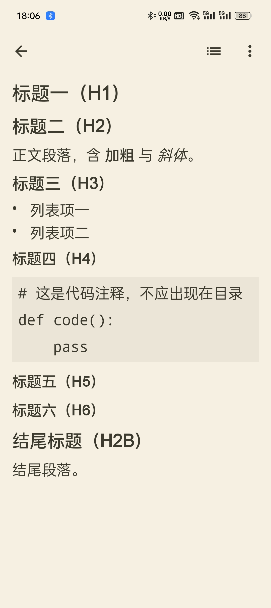{width=38mm} |
| 图 4-8 夜间黑 | 图 4-9 默认白 |
| 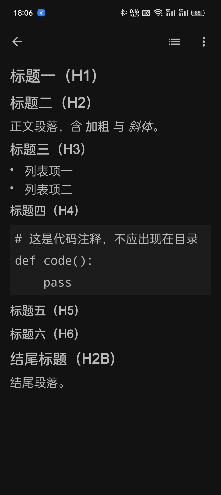{width=38mm} | 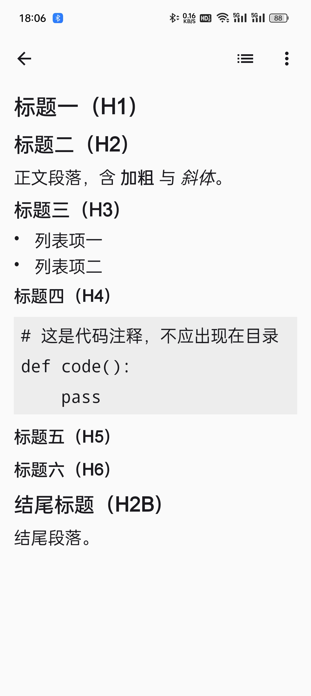{width=38mm} |
:::

## 4.7 文本选择与复制

1. 正文长按进入选择状态，拖动手柄调整选区。
2. 用系统选择菜单复制。
3. 复制后若已启用「问 AI」并选定了目标应用，屏幕下方出现「已复制：……」提示，可点「问 AI」交给目标应用；不点则不发送（详见第 7 章）。

## 4.8 md 预览与源码视图

打开 md 文件后可在「⋮」菜单切换两种视图：

- 源码视图：显示原始 Markdown 文本，便于查看和核对标记。
- 预览视图：只读渲染标题、段落、列表、引用、代码块、加粗、斜体、表格等基本元素。
- 两种视图的目录、阅读位置、进度互相对应。预览视图不可编辑，修改请进编辑界面。

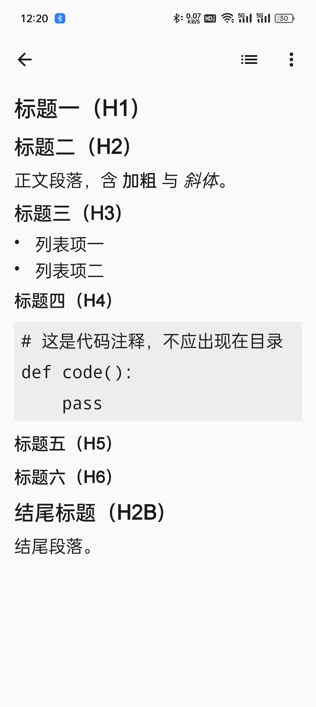{width=60mm}

## 4.9 epub 图文显示

- 正文插图按屏宽等比缩放；懒加载并按尺寸采样解码，控制内存占用。
- 封面取自 epub 的 OPF 声明（meta cover 或 properties=cover-image），显示在正文开头。
- 图片缺失、损坏、格式不支持时显示「图片不可用」占位，不阻塞正文。
- SVG 矢量图不直接渲染，统一显示占位；SVG 封面若内嵌位图引用，则提取其中位图作封面。
- 图片带替代文字（alt）时，alt 会显示在占位里。

## 4.10 epub 样式与标题层级

本软件对 epub 应用一个基本 CSS 子集：字号、字重、斜体、文字颜色、对齐、段间距、行距。不支持的属性与复杂布局直接忽略，样式解析失败时回退为纯文本，任何书都能读。

- 全局设置为绝对基准：用户设置的字号、行距、字体、主题优先；书内 CSS 的字号、行距只作相对倍率叠加。
- 字重、斜体、对齐按书内声明直接生效。
- 书内文字颜色与当前主题背景对比度过低（按 WCAG 4.5:1 判定）时，回退为主题前景色。
- 书内 H1~H6 未声明字号时，按 1.6/1.45/1.3/1.2/1.1/1.05 的比例加粗显示；书内已声明字号则以书为准。
- 用 `
` 等非标题标签表达层级的书（部分 Calibre 导出作品如此），标题可能与正文无差异——本软件以「标题可区分、内容完整可读」为目标，不追求完全还原书籍版式。

# 5 文档编辑

## 5.1 进入与退出编辑

1. 打开 md 或 txt 文件后，点「⋮ → 编辑」。
2. 编辑界面顶部依次为返回、撤销、重做、保存按钮。
3. 有未保存修改时点返回，弹出「未保存的更改」对话框，三选一：
   - 保存：写回原文件后退出；
   - 放弃：丢弃本次修改并退出；
   - 取消：留在编辑界面。

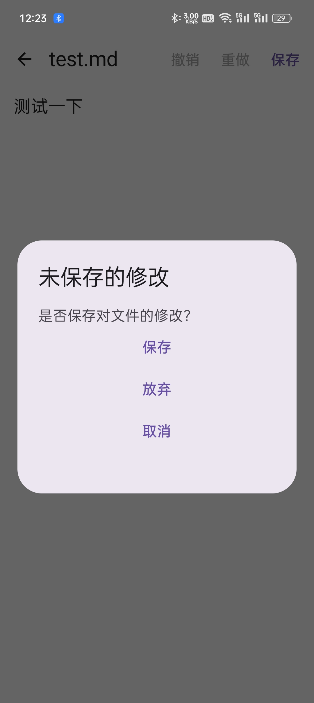{width=60mm}

epub 与 xml 只读，不出现编辑入口。

## 5.2 编辑操作

- 在正文区直接输入、删除、修改。
- 「撤销」回退一步，「重做」恢复；历史最多 100 步。
- 编辑区始终软换行显示，与阅读界面的换行设置无关。
- 编辑界面与阅读界面共用同一套字号、行距、字体、主题设置。

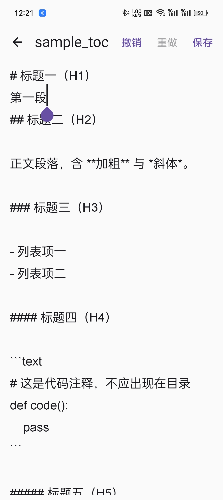{width=60mm}

## 5.3 保存

1. 有改动后顶部「保存」按钮变为可用。
2. 点击后内容写回原文件。
3. 成功后提示「已保存」，并更新已保存基线，此时退出不再提示未保存。
4. 失败时提示「保存失败」，常见原因是文件提供方不支持写入或文件只读。可改把内容复制到其他可写应用，或在「下载」等本地目录新建 md/txt 再编辑保存。

## 5.4 自动保存

默认关闭。开启路径：设置页 →「编辑器」→「自动保存」。开启后内容停顿约 3 秒即写回原文件，无需手动点保存。仅对 md、txt 生效；文件提供方不支持写入时自动保存同样失败，请注意界面提示。

## 5.5 草稿恢复

编辑中内容每次变化约 1 秒后，未保存部分会写入应用私有目录作草稿。应用进程被系统回收或设备意外重启后，再次打开同一文件进入编辑界面时，自动恢复草稿内容与光标位置，并标记为「未保存」。

以下情况草稿被清除：成功保存；退出对话框中选「放弃」；退出编辑界面且无未保存内容。草稿只存本机私有目录，不上传、不同步。

## 5.6 大文件处理

- 大文件分块读取、异步解析，不阻塞界面，避免长时间白屏或「应用无响应」。
- 超过 2 MB 的 md/txt 以只读打开，「编辑」菜单项置灰并标注「文件超过 2 MB，只读」；阅读、选择、复制不受影响。
- epub、xml 本来就只读，不受 2 MB 限制影响。

# 6 设置

首页右上角「设置」进入设置页，分「通用」「字体方案」「编辑器」「阅读默认值」「问 AI」五组。

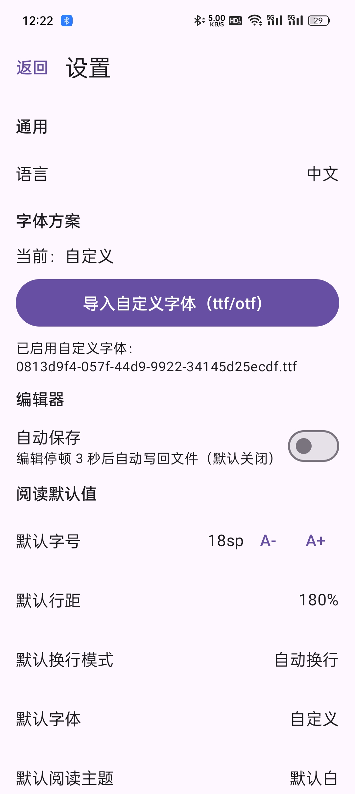{width=60mm}

## 6.1 通用

「语言」提供三项：跟随系统（默认）、中文、English。

操作方式：点击语言行弹出单选对话框，列出全部选项并标记当前值；选定新语言后弹出确认框「切换语言需要重启应用，是否立即重启？」——点「立即重启」保存并重启应用，点「取消」不做改动。

手动选定的中文/英文优先于系统语言；选「跟随系统」恢复自动跟随。语言设置只改界面文字，不动文档内容。

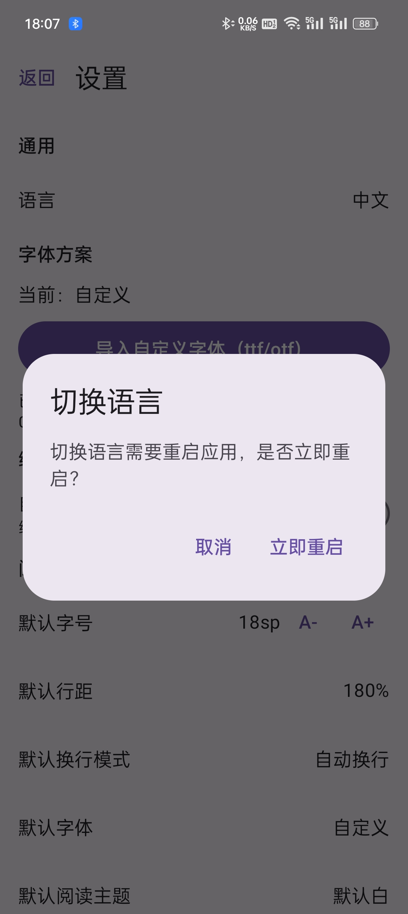{width=60mm}

## 6.2 字体方案

选择阅读与编辑界面的默认字体：代码 / 衬线 / 无衬线 / 自定义（导入过自定义字体才出现）。

点击字体方案行，在弹出的单选对话框中点选即生效。导入入口在阅读设置面板的「字体」分组；导入成功后此处可选「自定义」。

## 6.3 编辑器

「编辑器」分组只有「自动保存」开关，默认关，说明见 5.4 节。

## 6.4 阅读默认值

四项默认值均以「点击行 → 单选对话框 → 点选生效」操作：

| 设置项 | 可选值 | 默认值 |
| --- | --- | --- |
| 默认字号 | 12、14、16、18、20、22、24 sp | 16 sp |
| 默认行距 | 120%、150%、180%、200% | 150% |
| 默认换行模式 | 自动换行、不换行 | 自动换行 |
| 默认字体 | 代码、衬线、无衬线、自定义 | 代码 |
| 默认阅读主题 | 跟随系统、默认白、护眼绿、柔光米黄、夜间黑 | 跟随系统 |

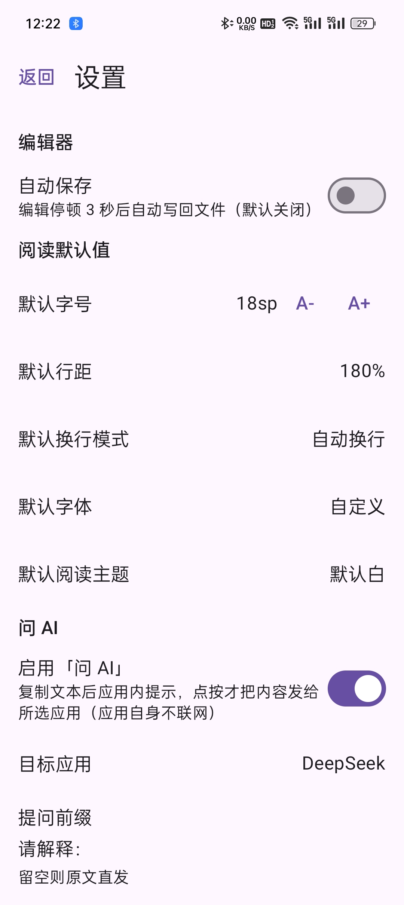{width=60mm}

阅读默认值同时作用于阅读与编辑界面；阅读设置面板里的调整也会写回全局，两处始终一致。

## 6.5 问 AI

「问 AI」分组包含：

- 启用「问 AI」开关：默认开。关闭后复制不再出现提示，菜单里的「问 AI」会提示功能未启用。
- 目标应用：列出可接收文本的已安装应用，含 DeepSeek、豆包两个内置预设及系统内其他支持文本分享的应用；必须选定一个才生效。
- 提问前缀：默认「请解释：」，发送时拼在原文前；清空则直接发送原文。

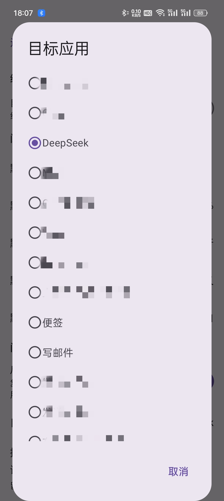{width=48mm}

候选列表由 Android 系统的包可见性机制给出，不产生任何网络请求。详见第 7 章。

# 7 复制后问 AI

## 7.1 功能说明

「复制后问 AI」把阅读中复制的文字快速转给用户指定的第三方 AI 应用。本软件不内置模型、不提供问答，也不会替用户发送——只在用户点按提示按钮时执行一次系统分享（ACTION_SEND，text/plain，并指定目标应用包名，不弹系统分享面板）。

## 7.2 使用前提

1. 设置页「问 AI → 启用‘问 AI’」处于开启状态；
2. 「目标应用」已选定一个应用；
3. 该应用已安装且可正常使用。

未选目标应用时复制后不出现提示；此时点阅读器菜单的「问 AI」，会提示「请先在设置中选择目标应用」。

## 7.3 操作步骤

1. 阅读界面长按选择文字，用系统菜单复制。
2. 应用在前台时，屏幕下方浮出「已复制：……」提示，带「问 AI」按钮。
3. 点「问 AI」，本软件把「提问前缀 + 复制文本」发给目标应用。
4. 目标应用收到后自行决定如何呈现（例如填进输入框）；是否发送由用户在该应用内确认，本软件不代发。

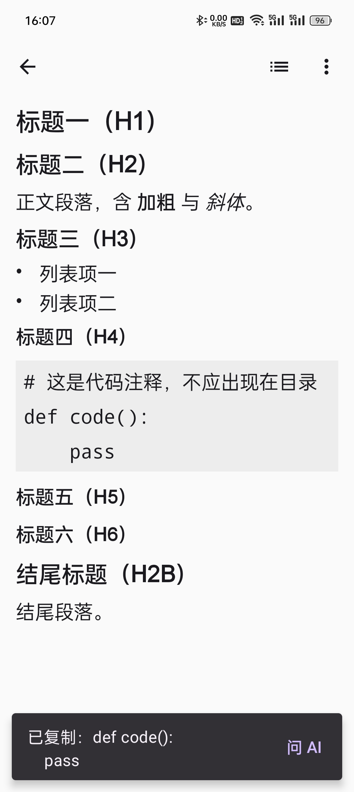{width=60mm}

补充说明：

- 只有应用在前台时才提示，后台不监听。
- 同一段文字不会连续重复提示。
- 不点按钮就不会发送任何内容。
- 「⋮」菜单里的「问 AI」是手动兜底入口，读取当前剪贴板并按同样规则发送。
- 目标应用被卸载、禁用或不支持接收文本时，提示「目标应用不可用，请在设置中重新选择」。

# 8 数据存储与隐私

## 8.1 本机保存的数据

| 数据 | 存放位置 | 用途 |
| --- | --- | --- |
| 阅读与功能设置 | 应用私有 DataStore | 字号、行距、换行模式、字体、主题、自动保存、语言、问 AI 配置 |
| 最近文件 | 应用私有 Room 数据库 | 文件名、地址、格式、打开时间 |
| 阅读进度 | 应用私有 Room 数据库 | 上次阅读位置（章节与段落坐标） |
| 编辑草稿 | 应用私有目录 `edit_recovery` | 进程回收后的内容恢复 |
| epub 缓存 | 应用缓存目录 | 加速已打开 epub 的图片读取，按 LRU 淘汰，不删当前书 |
| 自定义字体 | 应用私有目录 `fonts` | 用户导入字体的副本 |

以上数据不出设备；卸载时随应用私有目录一并删除。用户经系统选择器授权打开的文件留在原位置，不受卸载影响。

## 8.2 网络与权限

- 不声明网络权限，无法主动联网。
- 不申请 `MANAGE_EXTERNAL_STORAGE`，不绕过分区存储。
- 文件访问仅经系统文件选择器与文档提供方接口。
- 不含账号、广告、统计、崩溃上报及任何遥测组件。

## 8.3 剪贴板与第三方应用

启用「问 AI」后，本软件仅在前台时读取剪贴板用于判断是否显示提示，不保存、不上传。只有用户点按「问 AI」时，文字才经系统分享交给所选第三方应用，之后如何处理由该应用及其隐私政策决定。

# 9 常见问题

## 9.1 无法打开文件

可能原因：文件被移动、重命名或删除；所在应用（云盘）未运行或授权失效；无读取权限。

处理：重新「打开文件」选择；云盘文件先启动对应应用；必要时在系统设置里重新授权。

## 9.2 提示「不支持的文件格式」

本软件只支持 epub、xml、md、txt。请确认扩展名与实际格式一致；把其他格式直接改后缀也可能解析失败。

## 9.3 epub 打开失败

- 「epub 缺少 OPF 描述文件」：文件结构不完整，多半不是标准 epub，可换阅读器验证是否损坏。
- 「内容解析失败」：文件损坏，或使用了暂不支持的压缩/加密方式。
- 图片「图片不可用」：图片缺失、SVG 格式或解码失败，不影响正文。

## 9.4 中文乱码

txt 乱码时，「⋮ → 阅读设置 → 编码」手动切换：简体中文旧文件试 GBK；带 BOM 的 Unicode 文件试 UTF-8 / UTF-16LE；其他西文编码试 Latin-1。

## 9.5 无法编辑

- epub、xml 只读。
- md/txt 超过 2 MB 只读，菜单显示「文件超过 2 MB，只读」。
- 「编辑」可用但保存失败：文件提供方不支持写入，请换支持写入的本地目录。

## 9.6 保存失败

原因：只读文档提供方；文件被占用或权限被撤销；存储空间不足。

处理：确认位置可写；复制内容到其他应用；或在「下载」目录新建文件重存。保存失败不丢草稿，可返回重试。

## 9.7 自动保存没有生效

依次确认：设置页「编辑器 → 自动保存」已开；当前编辑的是 md/txt；文件位置支持写入；停顿已满约 3 秒。

## 9.8 导入字体失败

- 确认是有效的 ttf/otf 文件；部分文件后缀正确但内部损坏或不含可用字形。
- 确认对该字体文件有合法使用权。

## 9.9 问 AI 没有反应

依次检查：开关是否开启；是否选定目标应用；复制后应用是否在前台；目标应用是否已安装且未禁用。目标不可用时在设置里另选一个可接收文本的应用。

## 9.10 切换语言后界面没有变化

需在确认框点「立即重启」；点「取消」设置不变。重启后仍未变，请确认选的是「中文」或「English」而非「跟随系统」。

## 9.11 阅读进度没有恢复

进度按文件地址记录。文件被移动、重命名或换了一个文档提供方打开时，系统视为新文件，无法关联旧进度。

# 10 版本信息

| 项目 | 内容 |
| --- | --- |
| 软件全称 | 简记文档阅读编辑软件 |
| 英文名称 | Sample Note |
| 版本号 | V1.0 |
| 版本说明 | 登记版本 V1.0 对应应用内部版本 0.0.1 |
| 软件分类 | 应用软件 |
| 运行平台 | Android 8.0（API 26）及以上 |
| 开发语言 | Kotlin |
| 界面框架 | Jetpack Compose + Material 3 |
| 数据存储 | DataStore Preferences、Room |
| 网络依赖 | 无 |
| 编制日期 | 2026 年 10 月 |

---

本说明书说明本软件的功能、操作方法与运行环境。实际界面可能因 Android 版本、厂商定制略有差异，功能以软件实际表现为准。
